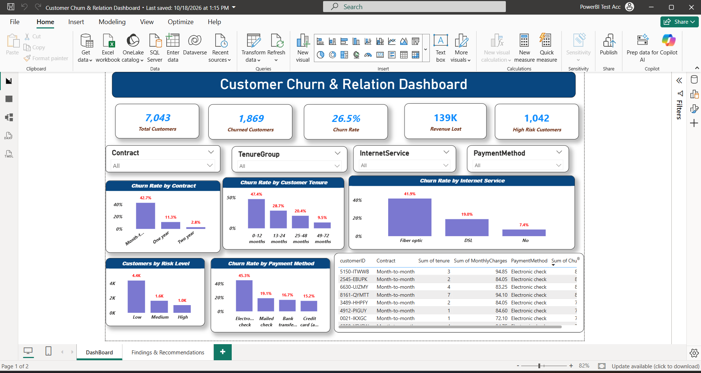
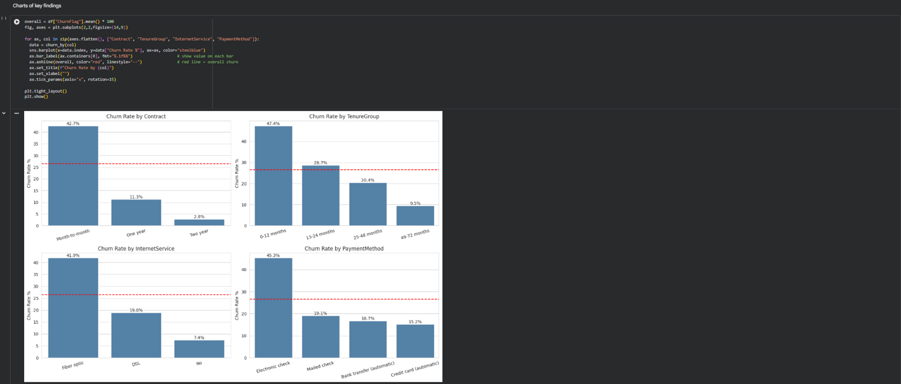
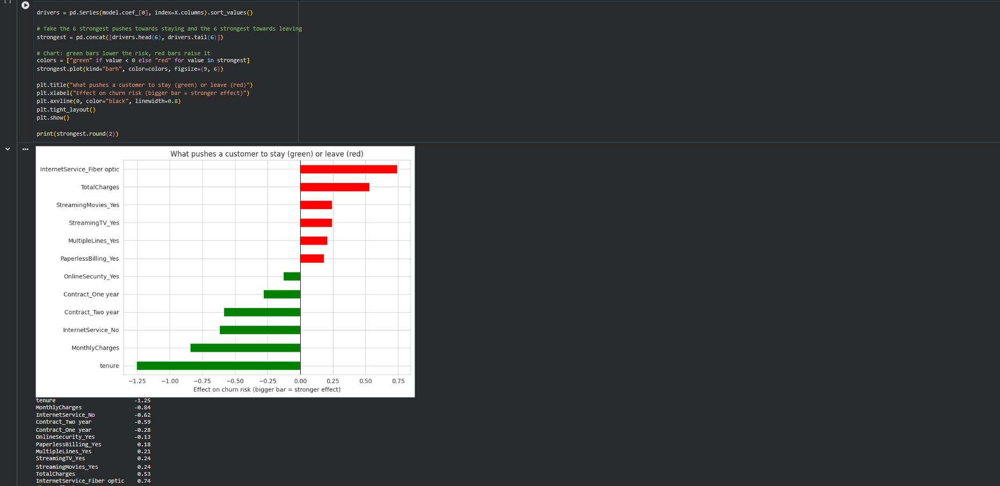
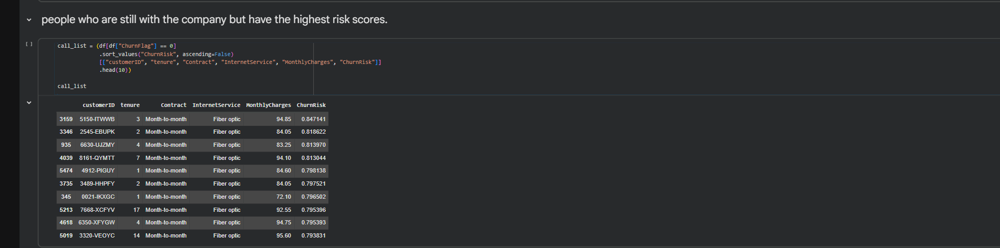

# Customer Churn & Retention Analysis

A telecom analytics project that answers five business questions: how bad is customer churn, who is leaving, why, who might leave next, and what the company should do about it.

**Tools:** Python (pandas, scikit-learn, matplotlib, seaborn), SQL Server, Power BI



## Business problem

A telecom company loses a large share of its customers every period and wants to know where the churn comes from and how to reduce it. I analysed 7,043 customers to answer five questions:

1. How bad is the problem?
2. Who is leaving?
3. Why are they leaving?
4. Which current customers might leave next?
5. What should the company do about it?

## Key findings

- **26.5%** of customers churned (1,869 of 7,043), taking about **139,000 a month** in revenue, which is **30.5%** of the total. Customers who left paid more on average (74.44 against 61.27).
- **Month-to-month** contracts churn at **42.7%**, against 11.3% for one-year and 2.8% for two-year contracts.
- Customers in their **first year** churn at **47.4%**, falling to 9.5% after four years.
- **Fiber optic** customers churn at 41.9%, against 19.0% for DSL.
- The riskiest profile (month-to-month, first year, fiber optic) is **916 customers churning at 70.2%**.
- Gender has almost no effect on churn.
- **Model:** logistic regression (AUC about 0.84). A balanced version catches 78% of churners. Customers scored High risk really churned at 71.8%, against 9.8% for Low risk.

## Results

### Who is leaving?


### What drives churn?


### Who should the retention team call first?


## Recommendations

1. Move month-to-month customers onto yearly contracts, for example with a discount, and test it first with a pilot.
2. Focus retention effort on the first year of the customer relationship.
3. Investigate the fiber optic experience (price, reliability, speed). The data shows the link but not the reason.
4. Contact High-risk customers first: 1,042 customers, about 40% of all churners.

## Project structure

```
customer-churn-retention-analysis/
├── README.md
├── data/
│   ├── Telco_Churn_Cleaned.csv
│   └── Telco_Churn_Scored.csv
├── notebooks/
│   └── Customer_Churn_Analysis.ipynb
├── sql/
│   └── churn_analysis.sql
├── powerbi/
│   └── Churn_Dashboard.pbix
└── images/
    ├── churn_dashboard.png
    ├── churn_by_segment.png
    ├── churn_drivers.png
    └── retention_call_list.png
```

## How to reproduce

1. Download the dataset from Kaggle (link below).
2. Open `notebooks/Customer_Churn_Analysis.ipynb` in Google Colab, upload the dataset, and run all cells. This cleans the data, answers the questions and saves `Telco_Churn_Scored.csv`.
3. In SQL Server, import `Telco_Churn_Cleaned.csv` into a table called `Churn_Cleaned` and run `sql/churn_analysis.sql`.
4. Open `powerbi/Churn_Dashboard.pbix` in Power BI Desktop. It reads `Telco_Churn_Scored.csv`, so point it at your copy of the file if asked.

## Data source

Telco Customer Churn dataset on Kaggle: https://www.kaggle.com/datasets/blastchar/telco-customer-churn

## Limitations

- The findings are patterns in the data, not proven causes.
- The data has no cost information for retention offers, so the project cannot say how many customers are worth contacting.
- The risk groups include customers the model saw during training, so the held-out test set is the honest measure of model quality.

## Author

Rupesh, M.Tech in AI

GitHub: [rupeshMadddula](https://github.com/rupeshMadddula) | LinkedIn: https://www.linkedin.com/in/rupesh-maddula/
